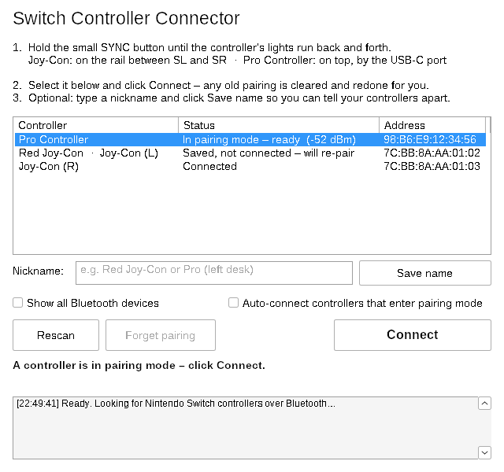

# Switch Controller Connector

[](https://github.com/TymonBitesTheDust/Switch-Controller-Connector/releases/latest)
[](https://github.com/TymonBitesTheDust/Switch-Controller-Connector/releases)


A small Windows app that connects Nintendo Switch controllers (Pro Controller and Joy-Con) to your PC over Bluetooth, including ones Windows has paired before and won't reconnect.



## Download

**[⬇ Download the latest version](https://github.com/TymonBitesTheDust/Switch-Controller-Connector/releases/latest/download/SwitchControllerConnector.exe)**

It's a single `.exe`: no install and no admin rights needed. Older versions and release notes are on the [Releases page](https://github.com/TymonBitesTheDust/Switch-Controller-Connector/releases).

> Windows SmartScreen may warn you the first time because the app isn't code-signed. Click **More info → Run anyway**.

## Why you need it

Once you sync a controller with a Switch, the controller forgets its pairing with your PC. Windows still lists it as "Paired", so it never shows up as a new device and won't connect. This app removes the old pairing and pairs again in one click.

## How to use

1. Hold the small **SYNC** button on the controller until the lights run back and forth.
   - Joy-Con: on the rail, between SL and SR.
   - Pro Controller: on top, next to the USB-C port.
2. Select the controller in the list and click **Connect**.
3. Optional: type a nickname and click **Save name** so you can tell your controllers apart.

| Button / option | What it does |
|---|---|
| **Connect** | Clears any old pairing and pairs the controller again. Keeps trying for about 45 seconds. |
| **Auto-connect** | Connects any controller as soon as it enters pairing mode. |
| **Forget pairing** | Removes Windows' saved pairing for the selected controller. |
| **Rescan** | Restarts the search (and tries to turn Bluetooth on if it's off). |
| **Save name** | Gives the controller a nickname, shown in the app and in Windows' Bluetooth list. |

The controller's lights keep cycling after it connects. That's normal on a PC.

## Troubleshooting

| Problem | Fix |
|---|---|
| Controller doesn't appear | Hold SYNC until the lights *run*, not just blink. Move closer to the PC and check Bluetooth is on. |
| "Couldn't pair… no answer from the controller" | It left pairing mode. Hold SYNC again and click Connect. |
| "Couldn't remove the old pairing" | Remove it in **Settings → Bluetooth & devices**, then click Connect. |

The log at the bottom of the window shows each step if you need more detail.

## Build from source

Requires [Rust](https://rustup.rs) and MinGW (for `windres`, which adds the icon).

```
rustup target add x86_64-pc-windows-gnu
cargo build --release --target x86_64-pc-windows-gnu
```

The exe is created at `target/x86_64-pc-windows-gnu/release/switch-connector.exe`.

## Publishing a new release

1. Update the version in `Cargo.toml` and in `res/app.rc` (`FILEVERSION`, `PRODUCTVERSION` and the version strings).
2. Build the exe (see above) and rename it to **`SwitchControllerConnector.exe`**.
3. On GitHub, go to **Releases → Draft a new release**, create a tag such as `v1.1.0`, write what changed, attach the exe, and click **Publish release**.

Keep the file name exactly `SwitchControllerConnector.exe`: the download link at the top of this README always fetches the file with that name from the newest release.

## Built with

Rust, the [`windows`](https://crates.io/crates/windows) crate (WinRT Bluetooth pairing APIs) and [`native-windows-gui`](https://crates.io/crates/native-windows-gui).
